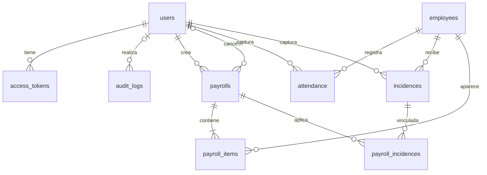

# Base de datos en XAMPP

La base nueva se llama **`nomina_octavio_servicios`**. La conexión local usa **127.0.0.1**, puerto **3306**, usuario `root` y contraseña vacía por defecto. PHP usa PDO para comunicarse con MySQL/MariaDB; el navegador y los clientes Python/PHP usan la API HTTP.

## Crear la base desde cero

Inicia MySQL en el panel de XAMPP y ejecuta desde la carpeta del proyecto:

```powershell
& 'C:\xampp\php\php.exe' scripts/install.php --demo
```

El instalador crea la base y las **diez tablas** de [`database/schema.sql`](../database/schema.sql). Después agrega un administrador y seis empleados ficticios. Para crear tu administrador omite `--demo`.

Se puede ejecutar otra vez sin borrar ni duplicar esos registros. Crear la base nueva conserva cualquier base anterior llamada `nomina_octavio`. Si necesitas una instalación vacía independiente para practicar, elige otro nombre antes de ejecutar el instalador:

```powershell
$env:NOMINA_DB_NAME = 'nomina_practica'
& 'C:\xampp\php\php.exe' scripts/install.php --demo
```

La variable solo afecta a esa terminal y a los programas que inicies desde ella. La conexión predeterminada se define en [`config.php`](../config.php); las variables `NOMINA_DB_HOST`, `NOMINA_DB_PORT`, `NOMINA_DB_NAME`, `NOMINA_DB_USER` y `NOMINA_DB_PASSWORD` tienen prioridad.

Para ver la base en XAMPP, inicia también Apache, abre **http://localhost/phpmyadmin** y selecciona **nomina_octavio_servicios**. El puerto 3306 corresponde a MySQL; el servidor web de desarrollo usa 8088.

También puedes crear y seleccionar la base en phpMyAdmin e importar `database/schema.sql`. Ese archivo crea la estructura; ejecuta el instalador para crear el usuario con el hash de su contraseña y los datos demo.

## Actualizar una instalación existente

Con la base actual configurada, ejecuta antes de iniciar esta versión:

```powershell
& 'C:\xampp\php\php.exe' scripts/install.php --migrate-only
```

Además de crear las tablas faltantes, el instalador aplica una migración aditiva e idempotente para admitir cancelaciones: incorpora el estado `cancelled` y los campos `cancelled_at`, `cancelled_by` y `cancellation_reason`, agrega la clave foránea del autor de cancelación hacia `users` y sustituye la unicidad global de incidencias aplicadas por un índice de consulta. Conserva cuentas, contraseñas, empleados, nóminas, detalles y relaciones existentes. Repetir el comando reconoce los cambios ya aplicados.

`--migrate-only` termina tras actualizar el esquema, sin pedir ni agregar usuarios o empleados. `scripts/install.php --demo` también aplica la misma migración y agrega los datos demo que falten.

La migración de Usuarios y Auditoría agrega `users.status` con valor inicial `active` cuando falta, crea `audit_logs` si no existe y agrega sus columnas `actor_name`, `summary` e índices faltantes. Conserva las cuentas, hashes de contraseña y registros de auditoría anteriores. Los registros históricos que carecían de esos campos reciben las etiquetas `Usuario histórico` y `Registro histórico`; la migración no inventa acciones pasadas.

Importar solamente `schema.sql` en una base existente no actualiza las tablas que ya estaban creadas; utiliza el instalador para realizar la migración.

## Tablas y servicios que las usan

| Tabla | Servicio principal | Para qué sirve |
| --- | --- | --- |
| `users` | Autenticación y Administración de usuarios | Usuarios de acceso, hash de contraseña, rol y estado `active`/`inactive`. |
| `audit_logs` | Auditoría | Autor, acción, recurso, identificador, resumen y fecha UTC de cada evento registrado. |
| `access_tokens` | Autenticación | Hashes de tokens de sesión, vencimiento y revocación. |
| `login_attempts` | Autenticación | Registro temporal de intentos de acceso para aplicar límites. |
| `employees` | Empleados | Expediente, sueldo mensual, fecha de ingreso y estado. |
| `attendance` | Asistencias | Registro diario `present`, `absent` o `paid_leave`. |
| `incidences` | Incidencias | Bonos y deducciones con fecha, concepto e importe positivo. |
| `payrolls` | Nóminas y Pagos | Periodo, totales, estado (`draft`, `paid`, `cancelled`), creador, fecha de pago y datos de cancelación. |
| `payroll_items` | Nóminas | Días e importes de cada empleado con copia de su expediente. |
| `payroll_incidences` | Nóminas | Relaciones históricas de incidencias aplicadas al generar desde registros, incluidas las nóminas canceladas. |

Cálculo opera con los datos de entrada y no necesita una tabla propia. Reportes consulta las tablas existentes. Pagos usa `payrolls.status` y `payrolls.paid_at`; no necesita una tabla de transferencias.

Una cancelación guarda `payrolls.cancelled_at` (UTC), `cancelled_by` (usuario administrador) y `cancellation_reason` (hasta 500 caracteres). Esos campos son `NULL` antes de cancelar y conservan sus valores originales al repetir la operación.

## Relaciones



Un **usuario** puede entrar al sistema. Un **empleado** es una persona incluida en la nómina. Crear un empleado no crea una cuenta de acceso.

## Reglas que protegen el historial

- `attendance` tiene una clave única por empleado y fecha.
- `payroll_items` permite un detalle por empleado en cada nómina.
- `payroll_incidences` tiene una clave primaria compuesta por `(payroll_id, incidence_id)` y un índice no único por `incidence_id`. Una incidencia puede aparecer en varias nóminas canceladas y en una sola vigente (`draft` o `paid`). El servicio valida esta última exclusividad bajo bloqueo del empleado; no existe una restricción SQL de unicidad global por incidencia.
- Las claves foráneas impiden registros que apunten a empleados, usuarios o nóminas inexistentes.
- Los importes usan `DECIMAL`; PHP calcula con centavos enteros.
- La creación de cabecera, detalles y relaciones con incidencias se realiza en una sola transacción.
- La API bloquea el empleado durante la generación y las modificaciones de sus registros. Así evita periodos solapados entre nóminas vigentes y cambios concurrentes en asistencias e incidencias.
- Una nómina vigente cierra su periodo para ese empleado, aunque siga como `draft`. Cancelarla libera el periodo y las incidencias para corrección y nueva generación sin borrar los vínculos históricos.
- Solo se admite pasar de `draft` a `paid` o a `cancelled`. Una pagada no se cancela; una cancelada no se paga. La primera cancelación conserva su fecha, autor y motivo, incluso si se repite.

El detalle de nómina conserva nombre, departamento, puesto, sueldo e importes originales, también cuando se cancela. Modificar el empleado o corregir sus incidencias afecta las nóminas siguientes, sin recalcular las anteriores. La API tampoco permite mover su fecha de ingreso después de una asistencia, incidencia o del final de un periodo ya generado, incluidas las nóminas canceladas.

Administración de usuarios bloquea las filas de cuentas durante cambios de acceso, revalida al administrador y su sesión, impide su propia desactivación/degradación y conserva al menos un administrador activo. Los cambios de correo, rol, estado o contraseña revocan las sesiones de esa cuenta. La API no elimina cuentas.

Auditoría agrega un evento dentro de la misma transacción de cada acción auditada: ambos se confirman o se revierten. La API solo permite consultar el historial como administrador; no expone operaciones para editarlo o borrarlo. Los eventos nuevos no contienen contraseñas ni tokens. Las fechas con hora se guardan en UTC. La pantalla de Auditoría muestra UTC explícitamente y sus filtros delimitan días UTC; otras pantallas pueden mostrar fechas según la zona del navegador.

## Consultas de ejemplo

Desde la pestaña SQL de phpMyAdmin:

```sql
SELECT employee_code, full_name, department, monthly_salary
FROM employees
WHERE status = 'active'
ORDER BY full_name;

SELECT e.employee_code, a.work_date, a.status
FROM attendance a
JOIN employees e ON e.id = a.employee_id
ORDER BY a.work_date DESC, e.employee_code;

SELECT e.employee_code, i.occurrence_date, i.type, i.concept,
       i.amount AS current_incidence_amount, applied.payroll_id,
       p.status AS payroll_status
FROM incidences i
JOIN employees e ON e.id = i.employee_id
LEFT JOIN payroll_incidences applied ON applied.incidence_id = i.id
LEFT JOIN payrolls p ON p.id = applied.payroll_id
ORDER BY i.occurrence_date DESC;

SELECT id, period_start, period_end, status, total_net, paid_at,
       cancelled_at, cancelled_by, cancellation_reason
FROM payrolls
ORDER BY id DESC;
```

La consulta de incidencias muestra todos sus vínculos históricos, por lo que una incidencia puede aparecer en varias filas. Su importe es el actual; los importes calculados originalmente se consultan en `payroll_items`. Los listados y reportes mantienen las nóminas canceladas, mientras que el indicador `last_run_total` del tablero usa la última no cancelada.

Las pruebas HTTP usan una base temporal con nombre `nomina_test_` seguido de un identificador aleatorio. La fixture verifica ese nombre antes de eliminarla y no modifica la base principal.
