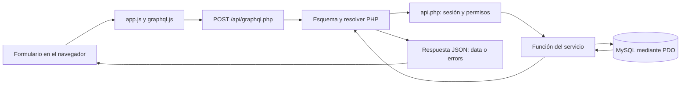

# Guía para explicar Nómina Clara

## Explicación de un minuto

«Es una aplicación de nómina hecha con PHP, JavaScript y MySQL/MariaDB. Permite registrar empleados, capturar asistencias, agregar bonos o deducciones y generar una nómina por periodo. La interfaz se comunica con PHP mediante GraphQL. PHP valida los datos, verifica los permisos, calcula los importes y guarda el resultado en MySQL. También permite cancelar un borrador, registrar una nómina como pagada y descargar reportes CSV. Los servicios son archivos de funciones dentro de una sola aplicación.»

Hay **ocho servicios principales y dos módulos auxiliares** implementados. **Administración de usuarios** permite crear y editar cuentas, roles, estado y contraseñas. **Auditoría** conserva un historial de acciones exitosas con autor y fecha UTC. Sus pantallas y operaciones de API requieren administrador.

## El recorrido de una petición



Por ejemplo, al guardar un empleado:

1. El formulario entrega nombre, sueldo y demás campos a JavaScript.
2. `graphql.js` construye la mutación `createEmployee` y `app.js` la envía con `fetch` y el token.
3. `public/api/graphql.php` recibe el JSON. La biblioteca `webonyx/graphql-php` valida la operación contra el esquema.
4. El resolver de `src/graphql/server.php` llama a `api_data('employees', 'POST', ...)`.
5. `src/api.php` verifica la sesión y exige el rol `admin` para escribir.
6. `EmployeeService.php` valida los valores y ejecuta SQL preparado mediante PDO.
7. GraphQL devuelve los campos solicitados y la interfaz actualiza la pantalla.

El navegador nunca se conecta directamente a MySQL. GraphQL no sustituye las reglas del servicio ni las validaciones de la base.

## Qué hace cada servicio

| Servicio | Función |
| --- | --- |
| Autenticación | Iniciar/cerrar sesión, comprobar token y rol, cambiar la propia contraseña y administrar sesiones propias. |
| Empleados | Registrar y actualizar el expediente, sueldo y estado de cada empleado. |
| Asistencias | Guardar asistencia, falta o permiso pagado por empleado y fecha. |
| Incidencias | Guardar bonos y deducciones con concepto, importe y fecha. |
| Cálculo | Validar fechas e importes y calcular sueldo base, bruto y neto. |
| Nóminas | Previsualizar, generar, consultar y cancelar borradores; guardar el detalle histórico. |
| Pagos | Marcar una nómina como pagada y conservar la fecha del primer registro. |
| Reportes | Obtener indicadores y descargar archivos CSV. |
| Administración de usuarios | Crear y modificar cuentas, roles, estado y contraseñas; cerrar sesiones cuando cambia el acceso. |
| Auditoría | Registrar acciones exitosas en su misma transacción; consultar historial con filtros y paginación. |

Un servicio aquí es un archivo PHP con funciones relacionadas. Todos comparten servidor y base de datos; no hay que arrancar un proceso por servicio.

## Cómo se calcula y guarda una nómina

El usuario elige un periodo y empleados. Puede capturar días, bonos y deducciones manualmente o marcar **Usar asistencias y conceptos registrados**.

En el segundo modo, PHP consulta los registros del periodo: `present` y `paid_leave` cuentan como un día pagado; `absent` y los días sin registro cuentan como cero. Suma incidencias `bonus` y resta `deduction`. Al guardar, vuelve a consultar esos datos en el servidor, aunque el navegador ya haya mostrado una vista previa.

```text
Sueldo base = sueldo mensual × días pagados / 30
Bruto       = sueldo base + bonos
Neto        = bruto − deducciones

Ejemplo: 18,000 × 15 / 30 + 500 − 250 = 9,250 MXN
```

PHP calcula con centavos enteros para evitar errores de decimales y redondea el prorrateo al centavo. Se admiten periodos de 1 a 31 días, con un máximo de 30 días pagados y respetando la fecha de ingreso. No se permite un neto negativo.

La vista previa no guarda una nómina. La creación guarda la cabecera en `payrolls`, un detalle por empleado en `payroll_items` y, si se usaron registros, los vínculos con incidencias en `payroll_incidences`. Se hace dentro de una **transacción**: se confirma todo con `commit`; si falla algo, `rollBack` deshace la operación.

El detalle conserva una copia del nombre, puesto, departamento, sueldo e importes. Si después cambia el empleado, la nómina anterior mantiene sus datos originales.

Los estados son:

```text
draft (borrador) → paid (pagada)
draft (borrador) → cancelled (cancelada)
```

Una nómina vigente, incluso en borrador, impide otra nómina con fechas superpuestas para el mismo empleado y bloquea cambios en sus registros de ese periodo. Cancelar el borrador con un motivo libera el periodo, conserva el historial y permite corregir y generar otra nómina. Una pagada no se cancela y una cancelada no se paga. Repetir un pago o cancelación conserva sus datos originales.

El registro de pago solo cambia el estado; no hace una transferencia bancaria. El cálculo es educativo: no incluye ISR, IMSS ni CFDI.

## La base de datos

La configuración está en `config.php`. Por defecto se conecta a **`nomina_octavio_servicios`**, en **127.0.0.1:3306**, mediante PDO. El esquema está en `database/schema.sql`; `scripts/install.php` crea las tablas y, con `--demo`, agrega una cuenta y empleados ficticios.

| Tabla | Qué guarda |
| --- | --- |
| `users` | Cuentas que entran al sistema: nombre, correo, hash de contraseña, rol y estado. |
| `audit_logs` | Autor, acción, recurso, resumen y fecha UTC del evento. |
| `access_tokens` | Hash del token, usuario, vencimiento y revocación de la sesión. |
| `login_attempts` | Intentos de acceso para limitar los fallidos. |
| `employees` | Empleados que reciben nómina: expediente, sueldo e ingreso. |
| `attendance` | Asistencias de cada empleado por fecha. |
| `incidences` | Bonos y deducciones de cada empleado. |
| `payrolls` | Cabecera: periodo, totales, estado, creador, pago y cancelación. |
| `payroll_items` | Detalles e importes históricos por empleado y nómina. |
| `payroll_incidences` | Relación entre una nómina y las incidencias que utilizó. |

Son **diez tablas**. `scripts/install.php --migrate-only` actualiza instalaciones anteriores sin borrar cuentas, nóminas ni auditorías existentes y sin agregar datos de demostración.

Las relaciones principales son:

- Un usuario puede tener varias sesiones y crear varias nóminas o registros.
- Un empleado puede tener muchas asistencias, incidencias y detalles de nómina.
- Una nómina tiene varios detalles, uno por empleado incluido.
- `payroll_incidences` conecta nóminas e incidencias. Una incidencia puede quedar en varias nóminas canceladas, pero solo en una vigente.

`id` es la clave primaria que identifica una fila. Una clave foránea, como `attendance.employee_id`, apunta al `id` de otra tabla y evita referencias inexistentes. Una restricción única impide, por ejemplo, dos asistencias del mismo empleado en la misma fecha. Los importes se guardan como `DECIMAL`. Las transacciones y los bloqueos de filas coordinan operaciones que intentan modificar el mismo empleado.

**Usuario y empleado son distintos:** registrar un empleado no crea una cuenta para iniciar sesión.

## Endpoints y GraphQL

Un **endpoint** es la dirección HTTP a la que el cliente envía una petición. El puerto **8088** atiende la web; **3306** es el puerto de MySQL.

La interfaz usa un endpoint GraphQL:

```http
POST http://127.0.0.1:8088/api/graphql.php
Content-Type: application/json
Authorization: Bearer TOKEN
```

El cuerpo JSON contiene `query` (el documento GraphQL), `variables` si hacen falta y, opcionalmente, `operationName` para elegir una operación nombrada.

Una **query** consulta información. Una **mutation** representa una operación que cambia datos o sesión. Ambas viajan por POST en esta aplicación. El **schema** es el contrato de campos, argumentos y tipos permitidos. El **resolver** es la función PHP que obtiene los datos de un campo.

Ejemplo de consulta:

```graphql
query {
  employees { id full_name monthly_salary }
}
```

Se envía así, con el token recibido en el login:

```json
{"query":"query { employees { id full_name monthly_salary } }"}
```

Respuesta ilustrativa:

```json
{"data":{"employees":[{"id":"1","full_name":"Ana","monthly_salary":18000}]}}
```

Solo aparecen los campos seleccionados. Eso no significa que GraphQL escriba SQL automáticamente: el resolver llama al servicio, que contiene sus propias consultas SQL.

Ejemplo con variables para registrar el pago de una nómina existente:

```graphql
mutation Pagar($id: ID!) {
  payPayroll(id: $id) { payroll { id status paid_at } }
}
```

En el JSON, `variables` sería `{"id":"1"}` y `operationName`, `"Pagar"`. `ID!` significa que el identificador es obligatorio. Las variables separan los valores del texto de la operación. Esta mutación exige administrador y modifica datos: úsala solo con la nómina que realmente quieras marcar como pagada.

El esquema tiene **13 consultas y 15 mutaciones**. Ejemplos: `employees`, `attendance`, `incidences`, `payrolls`, `payroll`, `payrollPreview`, `dashboard`, `users` y `auditLogs`; `login`, `createEmployee`, `createPayroll`, `payPayroll`, `cancelPayroll`, `createUser` y `updateUser`. La lista completa está en [GRAPHQL.md](GRAPHQL.md).

La API REST sigue disponible para compatibilidad y descargas. Su base es `http://127.0.0.1:8088/api/index.php` y la ruta va en `?route=`:

| Método y ruta | Función |
| --- | --- |
| `POST ?route=auth/login` | Iniciar sesión. |
| `GET ?route=auth/me` | Consultar la identidad. |
| `GET / POST ?route=users` | Listar / crear cuentas; solo administrador. |
| `PATCH ?route=users/1` | Actualizar cuenta, rol, estado o contraseña; solo administrador. |
| `GET ?route=audit` | Consultar auditoría con filtros y paginación; solo administrador. |
| `GET / POST ?route=employees` | Listar / registrar empleados. |
| `PATCH ?route=employees/1` | Actualizar el empleado 1. |
| `GET / POST ?route=attendance` | Consultar / registrar asistencias. |
| `GET / POST ?route=incidences` | Consultar / registrar incidencias. |
| `GET ?route=payrolls/preview` | Vista previa; requiere parámetros de periodo. |
| `GET / POST ?route=payrolls` | Listar / crear nóminas. |
| `GET ?route=payrolls/1` | Consultar una nómina con sus detalles. |
| `POST ?route=payrolls/1/pay` | Registrar pago. |
| `POST ?route=payrolls/1/cancel` | Cancelar un borrador con motivo. |
| `GET ?route=reports/employees` | Descargar empleados en CSV. |
| `GET ?route=reports/payrolls/1` | Descargar detalle de nómina en CSV. |

Esta tabla resume las rutas principales; [API.md](API.md) contiene todas, sus argumentos y respuestas. REST y GraphQL pasan por `src/api.php`, así que usan los mismos permisos y reglas. Las descargas CSV viajan por REST porque la respuesta es un archivo.

## Autenticación y errores

`login` busca el correo y usa `password_verify` para comparar la contraseña con el hash creado por `password_hash`. Si coincide, entrega un token aleatorio. La base guarda solo su hash SHA-256 y el vencimiento. El navegador guarda el token en `sessionStorage` y lo envía en `Authorization: Bearer ...`.

Es un **token opaco, no un JWT**. PHP consulta la base para comprobar que siga vigente, no esté revocado y la cuenta esté activa. Cerrar sesión revoca el token actual; cambiar correo, rol, estado o contraseña de una cuenta revoca todas sus sesiones. `admin` puede modificar datos y consultar Usuarios y Auditoría; `viewer` puede consultar los datos de nómina, indicadores y CSV y gestionar su propia sesión, pero no usuarios ni auditoría. Ocultar botones no basta: el servidor también comprueba el rol.

En REST, los códigos frecuentes son 200 (correcto), 201 (creado), 400 (petición inválida), 401 (sin sesión válida), 403 (sin permiso), 404 (no existe), 409 (conflicto), 422 (dato inválido) y 429 (demasiados intentos).

En GraphQL hay que revisar **`errors` aunque HTTP sea 200**. Los errores de la aplicación incluyen `extensions.status`. Una operación puede devolver `data` parcial junto con errores. Las solicitudes HTTP inválidas sí pueden responder con otro código HTTP.

## Preguntas habituales

**¿Por qué GraphQL?** Permite pedir campos concretos y consultar varios datos en una petición. Aquí se usa una biblioteca de Composer para validar y ejecutar el esquema.

**¿Son microservicios?** No. Es una aplicación organizada por módulos de funciones PHP que comparten base y servidor.

**¿Dónde está la lógica principal?** En `src/services/`. `src/api.php` elige qué función ejecutar y comprueba permisos; `src/graphql/server.php` conecta los campos GraphQL con esas operaciones.

**¿Cómo evita SQL injection?** Los servicios usan SQL preparado con parámetros. Los valores del usuario no se concatenan directamente al SQL.

**¿Qué pasa si falla un empleado al generar la nómina?** La transacción revierte la creación, evitando guardar una nómina parcial.

**¿El navegador decide cuánto pagar?** Muestra una vista previa, pero PHP valida y calcula el resultado definitivo. El sueldo se obtiene del servidor; con `use_records: true` también los días e incidencias.

**¿Se borra una nómina para corregirla?** No. Se cancela el borrador con motivo, se corrigen los registros y se genera otra. El historial permanece.

**¿Cómo funcionan los dos servicios nuevos?** Usuarios administra cuentas de acceso y Auditoría registra acciones exitosas dentro de la misma transacción del cambio. Un error revierte el cambio y su evento; el historial es de solo lectura, con filtros y paginación para administradores. La [guía funcional](USUARIOS_Y_AUDITORIA.md) incluye ejemplos GraphQL y REST.

**¿Cómo lo ejecuto?** Inicia MySQL en XAMPP y usa `iniciar.ps1`. Para la primera instalación demo: `powershell -ExecutionPolicy Bypass -File .\iniciar.ps1 -InstalarDemo`. Abre `http://127.0.0.1:8088`. Las instrucciones y credenciales de demostración están en el [README](../README.md).

**¿Cómo lo compruebo?** Ejecuta `powershell -ExecutionPolicy Bypass -File .\comprobar.ps1`. Comprueba sintaxis, cálculo, interfaz, API REST, migración y GraphQL. Las pruebas HTTP usan bases temporales `nomina_test_*` y las eliminan al terminar.
