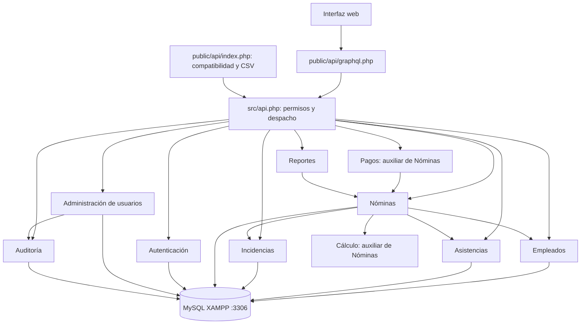

# Ocho servicios principales y dos módulos auxiliares

La interfaz consulta estos servicios mediante **GraphQL**, en `POST /api/graphql.php`. El [esquema](../src/graphql/schema.graphql) define las consultas y los tipos, y [mutations.graphql](../src/graphql/mutations.graphql) define las mutaciones. Los [resolutores](../src/graphql/server.php) llaman al despacho compartido de [src/api.php](../src/api.php), que verifica los permisos y ejecuta los servicios. Las rutas REST siguen disponibles para compatibilidad y exportación CSV. Véanse [operaciones y ejemplos](GRAPHQL.md).

El sistema se organiza en ocho servicios principales: **Empleados, Asistencias, Incidencias, Nóminas, Reportes, Autenticación, Administración de usuarios y Auditoría**, implementados como módulos PHP dentro de una aplicación común. No se ejecutan como microservicios o procesos separados: la API recibe la petición, verifica la sesión y llama a la función correspondiente. Todos comparten la base `nomina_octavio_servicios` en XAMPP, puerto 3306.

Se mantienen diez archivos en `src/services/`: ocho principales y dos de apoyo. Cálculo y Pagos pertenecen al flujo de Nóminas. Administración de usuarios y Auditoría cuentan con pantallas y operaciones de API exclusivas para administradores.

## Ubicación y responsabilidad

| Servicio | Archivo | Datos o resultado |
| --- | --- | --- |
| Empleados | [`EmployeeService.php`](../src/services/EmployeeService.php) | Expediente, sueldo, departamento y estado del empleado. |
| Asistencias | [`AttendanceService.php`](../src/services/AttendanceService.php) | Un registro por empleado y fecha, con asistencia, falta o permiso pagado. |
| Incidencias | [`IncidenceService.php`](../src/services/IncidenceService.php) | Bonos y deducciones por fecha, con su concepto e importe. |
| Nóminas | [`PayrollService.php`](../src/services/PayrollService.php) | Vista previa, generación, cancelación de borradores, detalles históricos y vinculación de incidencias. |
| Reportes | [`ReportService.php`](../src/services/ReportService.php) | Indicadores del tablero y exportaciones CSV. |
| Autenticación | [`AuthenticationService.php`](../src/services/AuthenticationService.php) | Comprobación de credenciales, tokens, sesiones, contraseñas y permisos. |
| Administración de usuarios | [`UserService.php`](../src/services/UserService.php) | Altas y cambios de cuentas, roles, estado y contraseñas; revocación de sesiones por cambios de acceso. |
| Auditoría | [`AuditService.php`](../src/services/AuditService.php) | Historial de acciones exitosas, con autor, recurso, resumen y fecha UTC; consulta filtrada y paginada. |

Los módulos auxiliares se modifican en sus propios archivos:

| Módulo | Archivo | Apoya a |
| --- | --- | --- |
| Cálculo | [`CalculationService.php`](../src/services/CalculationService.php) | Nóminas: validación de periodos y cálculo de sueldo base, bruto y neto. |
| Pagos | [`PaymentService.php`](../src/services/PaymentService.php) | Nóminas: cambio de estado a pagada y fecha del registro. |

## Cómo se conectan



## Un recorrido completo

**1. Acceso.** Autenticación valida correo y contraseña con `password_verify` y devuelve un token aleatorio. Las siguientes peticiones lo mandan en `Authorization: Bearer <token>`. La base conserva el hash SHA-256 del token y su vencimiento; en cada petición se verifica que no esté vencido ni revocado y que la cuenta esté activa. El administrador puede escribir; `viewer` puede consultar datos de nómina y reportes CSV, pero no Usuarios ni Auditoría. Ambos roles pueden gestionar su propia contraseña y sesiones. Cerrar sesión revoca el token actual; cambiar la contraseña revoca todas las sesiones del usuario. Las rutas de acceso están documentadas en [`AUTENTICACION.md`](AUTENTICACION.md).

**2. Expediente.** Empleados guarda el sueldo mensual y la fecha de ingreso. El identificador del empleado relaciona los registros posteriores. Desactivar al empleado conserva su historial.

**3. Captura diaria.** Asistencias registra `present`, `absent` o `paid_leave` por fecha. Una asistencia o permiso pagado vale un día; una falta vale cero. Un día sin capturar también vale cero. No se permite duplicar una fecha para el mismo empleado.

**4. Ajustes.** Incidencias guarda un importe positivo como bono o deducción. El tipo determina si suma o resta. Las incidencias se consideran directamente al calcular el periodo; no hay una etapa de autorización adicional.

**5. Vista previa.** Nóminas pide a Asistencias los días pagados y a Incidencias los importes del periodo; Cálculo obtiene el resultado con centavos enteros. La vista previa sirve para revisar y no guarda una nómina.

**6. Generación.** Al crear con `use_records: true`, Nóminas vuelve a consultar los registros en el servidor, calcula, guarda cabecera y detalles, y vincula las incidencias utilizadas. Todo ocurre en una transacción. Si falla algún empleado, no se guarda una nómina parcial. También existe el modo manual, que recibe días, bono y deducción por empleado.

**7. Historial y corrección.** Cada detalle conserva nombre, puesto, departamento y sueldo del momento de creación. Cambiar el expediente no modifica nóminas previas. Una nómina vigente (`draft` o `paid`) bloquea periodos solapados del mismo empleado y la modificación de sus asistencias e incidencias. El administrador puede cancelar un borrador con un motivo de 3 a 500 caracteres sin controles: queda como `cancelled`, con fecha, autor y motivo. Esto libera su periodo para corregir registros y generar una nueva nómina. Se conservan la cabecera, los detalles y los identificadores de incidencias de la cancelada. Una incidencia puede figurar en nóminas canceladas y en una sola vigente; los importes históricos no se recalculan. Repetir una cancelación conserva el motivo, autor y fecha originales.

**8. Pago y reporte.** Pagos cambia un borrador a `paid`. Repetir la operación conserva el primer registro. Una nómina pagada no se puede cancelar; una cancelada no se puede pagar. Reportes mantiene las canceladas en el historial e incluye su estado, motivo y fecha en el CSV. El importe de la última nómina del tablero corresponde a la última no cancelada. Registrar un pago no ejecuta una transferencia bancaria.

**9. Usuarios.** El administrador crea y edita cuentas con rol `admin` o `viewer`, estado `active` o `inactive` y contraseña de 12 a 72 bytes. Los cambios de correo, rol, estado o contraseña cierran las sesiones de la cuenta. No puede desactivarse ni quitarse a sí mismo el rol de administrador. Se conserva al menos un administrador activo mediante bloqueos transaccionales.

**10. Auditoría.** Las acciones exitosas de autenticación y los cambios de usuarios, empleados, asistencias, incidencias y nóminas registran autor, recurso y resumen en la misma transacción. Si falla el cambio, tampoco queda un evento de éxito. Los administradores consultan el historial de solo lectura con filtros y paginación; las fechas y filtros son UTC. No se guardan contraseñas ni tokens. Consulta [Usuarios y Auditoría](USUARIOS_Y_AUDITORIA.md).

## Dónde modificar cada regla

| Cambio deseado | Punto de entrada |
| --- | --- |
| Añadir una operación GraphQL | `src/graphql/schema.graphql` para consultas y tipos, `src/graphql/mutations.graphql` para mutaciones, y su resolutor en `src/graphql/server.php`. |
| Añadir una ruta REST o compartir su lógica con GraphQL | `src/api.php`; la entrada HTTP es `public/api/index.php`. |
| Cambiar inicio/cierre de sesión, validación de tokens o contraseñas | [`AuthenticationService.php`](../src/services/AuthenticationService.php). |
| Cambiar administración de cuentas, roles y estado | [`UserService.php`](../src/services/UserService.php). |
| Cambiar registro o consulta de auditoría | [`AuditService.php`](../src/services/AuditService.php); los eventos se agregan en la transacción de cada servicio. |
| Cambiar el cálculo o sus límites | [`CalculationService.php`](../src/services/CalculationService.php); comprobar con `tests/payroll_test.php`. |
| Agregar un campo al expediente | [`EmployeeService.php`](../src/services/EmployeeService.php), esquema SQL y formulario de empleados. |
| Cambiar qué días cuentan | [`AttendanceService.php`](../src/services/AttendanceService.php) y las pruebas de nómina desde registros. |
| Cambiar los conceptos de ajuste | [`IncidenceService.php`](../src/services/IncidenceService.php) y su formulario. |
| Cambiar la generación, cancelación o conservación del historial | [`PayrollService.php`](../src/services/PayrollService.php). |
| Cambiar el registro de pago | [`PaymentService.php`](../src/services/PaymentService.php). |
| Añadir indicadores o columnas CSV | [`ReportService.php`](../src/services/ReportService.php). |
| Cambiar conexión o credenciales de MySQL | `config.php`. |

Las rutas y ejemplos exactos están en [`API.md`](API.md). La estructura SQL se explica en [`BASE_DATOS.md`](BASE_DATOS.md).

## Cómo ejecutar todos los servicios

Inicia MySQL en XAMPP, abre PowerShell en la carpeta del proyecto y ejecuta:

```powershell
powershell -ExecutionPolicy Bypass -File .\iniciar.ps1 -InstalarDemo
```

Abre **http://127.0.0.1:8088** e inicia sesión con `admin@nomina.local` y `Nomina2026!` si acabas de instalar la demostración. El instalador conserva las cuentas existentes y sus contraseñas; también migra las bases anteriores para agregar cancelación, estado de las cuentas y auditoría sin borrar datos y sin repetir cambios ya aplicados. Deja abierta la terminal del servidor; `Ctrl+C` lo detiene. Para los siguientes arranques basta `powershell -ExecutionPolicy Bypass -File .\iniciar.ps1`.

Para actualizar únicamente el esquema de una instalación anterior, ejecuta `& 'C:\xampp\php\php.exe' scripts/install.php --migrate-only` antes del arranque. Esta opción conserva los datos y no agrega cuentas ni empleados de demostración.

Este único servidor atiende los ocho servicios principales y los dos módulos auxiliares. No hay que iniciar un puerto o comando por cada servicio. El procedimiento manual y las opciones de configuración están en el [`README`](../README.md).
